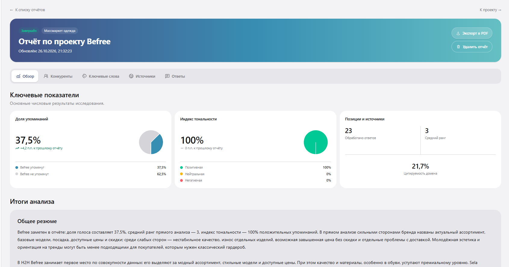
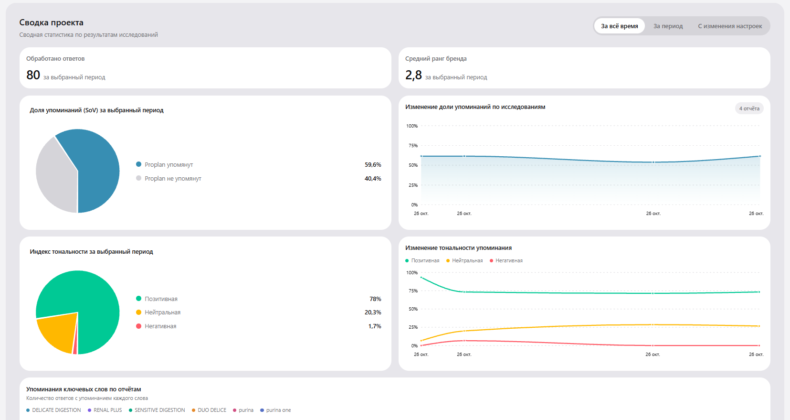
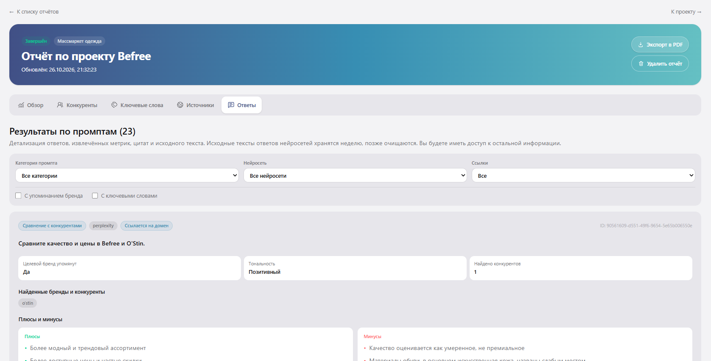

# AIbuzz

A full-stack GEO analytics app for tracking how brands appear in AI-generated answers. It runs configurable research prompts, analyzes AI responses, and turns the results into reports and historical dashboards.

## Preview

## Live Demo

https://aibuzz-rho.vercel.app

| Report overview                          | Project dashboard                             |
| ---------------------------------------- | --------------------------------------------- |
|  |  |

## Tech stack and architecture

- **Application:** Next.js 16 App Router, React 19, and TypeScript. Server-rendered pages handle data-driven views; route handlers provide the application API.
- **UI and charts:** Tailwind CSS 4, Base UI, and Recharts.
- **Data and access control:** Supabase PostgreSQL and Supabase Auth. Row Level Security limits anonymous access to explicitly marked demo data; privileged operations are server-side and require the configured administrator account.
- **AI integrations:** An OpenAI-compatible API via AI Tunnel. Perplexity Sonar supplies cited answers; the analysis pipeline uses language models to generate prompts, extract metrics, and summarize findings.

## Using the app

1. **Create a project.** Enter the brand and category, then add context such as competitors, location, tracked keywords, domain, and important pages.
2. **Review prompts.** The app generates research prompts for the project. Review and adjust them before saving; they are reused in subsequent research runs.
3. **Run research.** Start a study from the project page. Once processing is complete, open its report for an overview of brand visibility, share of voice, ranking, sentiment, and competitors, with separate sections for keywords, cited sources, and individual AI answers.
4. **Explore and refine.** The project page links to its report history and settings, and includes a dashboard for trends across studies. Filter the dashboard by time period to compare visibility, sentiment, and keyword results. Update project details, competitors, tracked items, or prompts in settings; future research runs use the revised configuration.

## Research pipeline

Each research run is a server-side workflow that keeps raw AI responses, extracted facts, and calculated metrics separate:

1. **Build the research set.** Project details and competitors are used to generate prompts for three distinct intents: general category discovery, direct brand research, and head-to-head comparisons. The prompts are saved to the project so they can be reviewed and reused across reports.
2. **Collect answers.** Each prompt is sent to Perplexity Sonar. The original response and its citations are stored against the report, preserving the evidence behind the analysis. Requests run in bounded batches to control concurrency.
3. **Extract structured signals.** A language model analyzes each answer in the project context and returns structured fields: brand mentions and ranking, sentiment, competitors, configured keywords, tracked domains and pages, and brand pros and cons. The response is parsed and validated against a Zod schema; incomplete or malformed output gets a second attempt.
4. **Calculate metrics.** Application code aggregates the extracted data into share of voice, average rank, sentiment distribution, competitor visibility, citation sources, keyword mentions, and tracked-source results. General discovery prompts drive the primary visibility metrics; direct-brand and head-to-head prompts are handled separately so different research intents are not mixed.
5. **Generate the narrative and finalize.** A summarization model turns the calculated metrics and bounded competitor/source evidence into report commentary and a head-to-head ordering. Its output is checked against the supplied brands before being stored. The report records a completed or failed status, while per-prompt results remain available for inspection.

The pipeline is split into focused stages for search, extraction, aggregation, and summarization. PostgreSQL stores projects, reusable prompts, reports, and per-prompt results; privileged database and AI operations run server-side.

## Current scope

This app is a pet-project not a multi-user SaaS: self-service registration and user account management are not implemented. Visitors can view public demo projects, including their settings and prompts, but only the administrator can change project settings, create projects, or run research.

The current version accesses AI models through an aggregation service. The integration is structured so that switching to direct APIs for individual providers would not require major changes to the research workflow. At present, research queries Perplexity only, but the analysis pipeline can also process responses from other AI providers.

## Deployment

### 1. Set up Supabase

1. Create a Supabase project.
2. In **SQL Editor**, run [`supabase/schema.sql`](./supabase/schema.sql) against the new, empty database. It is a snapshot of the current application schema, including its tables and RLS policies; do not use it as an incremental migration for an existing database. When adding tables later, enable RLS and define policies explicitly before exposing them.
3. In **Authentication → Users**, create the administrator account. Disable public sign-ups in the Auth settings; this app supports administrator sign-in, not self-service registration.
4. Add only sanitized demo projects and related data. Set `projects.is_demo` to `true` for projects intended for public viewing, and set their `user_id` to the administrator's Auth user ID. The schema contains no demo records.

### 2. Configure and deploy the app

Import the repository into Vercel and add these environment variables in **Project Settings → Environment Variables**:

| Variable | Value |
| --- | --- |
| `NEXT_PUBLIC_SUPABASE_URL` | Supabase project URL |
| `NEXT_PUBLIC_SUPABASE_ANON_KEY` | Supabase anon/public key |
| `SUPABASE_SERVICE_ROLE_KEY` | Supabase service-role key |
| `ADMIN_EMAIL` | Email address of the administrator account |
| `AITUNNEL_API_KEY` | API key for the AI aggregation service |
| `AITUNNEL_BASE_URL` | Base URL provided by the AI service |

Keep the service-role key and AI API key server-side: never prefix them with `NEXT_PUBLIC_` or commit them to the repository. Deploy from Vercel after setting the variables.

### 3. Verify the deployment

Open the deployed site in a signed-out browser and confirm that demo projects and reports are viewable while management and research actions are unavailable. Then sign in with the administrator account and verify that project management and a research run work. AI research requires a valid AI service key and available provider credits.

For local development, use Node.js 20.9 or later, copy `.env.example` to `.env.local` and fill in the values, then run `npm install` and `npm run dev`. Use `npm run lint` and `npm run build` to validate changes before deployment.
